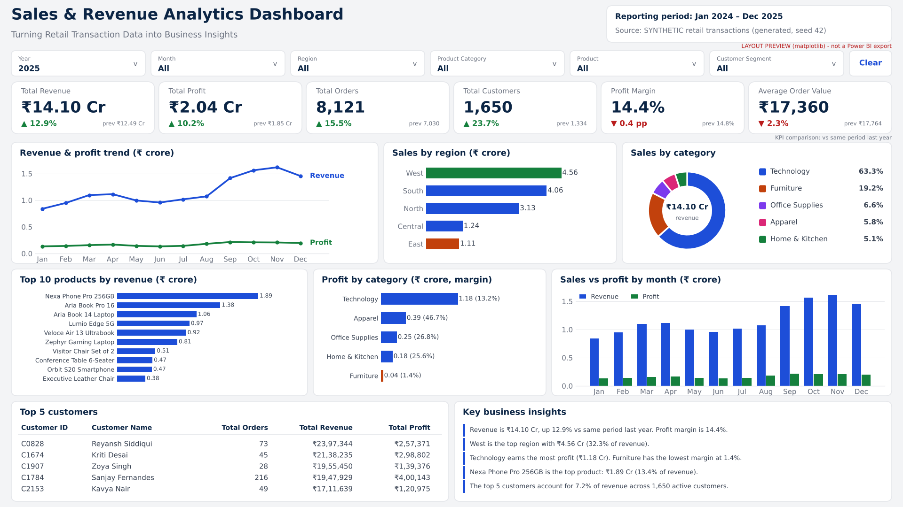

# Sales & Revenue Analytics Dashboard

An end-to-end retail analytics project: a reproducible **synthetic** transaction dataset, a documented cleaning pipeline, MySQL analytics, a Power BI data model with DAX, a companion Streamlit dashboard, and a test suite that reconciles every layer against the others.

> **The dataset is synthetic.** It was generated with a fixed random seed for this project. The company, customers, products, prices and every figure below are fictional and say nothing about any real business. The insights describe patterns that were built into the generator to practise analysis.



*Layout preview drawn with matplotlib from the real processed data on the Power BI canvas grid. It is **not** a Power BI export; see [Status](#status-what-is-and-is-not-included).*

## Status: what is and is not included

| Deliverable | Status |
|---|---|
| Synthetic dataset, cleaning pipeline, validation | done and executed (78 validation checks pass) |
| SQL analytics (CTEs, window functions) | scripts 02-04 executed on SQLite and reconciled to pandas (52 checks); script 01 (MySQL DDL, `LOAD DATA`) written for MySQL 8.0 but **not executed** |
| Power BI model, DAX, theme, build guide, reference values | written and complete; the DAX is **not executed** |
| Power BI `.pbix` file | **not included**: it must be built in Power BI Desktop by following [`powerbi/PowerBI_Build_Guide.md`](powerbi/PowerBI_Build_Guide.md) (about an hour) |
| Streamlit dashboard | done; smoke-tested headlessly (4 scenarios) |
| Tests | 100 pytest tests pass |

## Business problem and objectives

A retailer wants to see how revenue and profit are trending, where they come from (region, category, product, customer) and where margin is leaking, with figures that every team computes the same way. This project turns raw transactional data into that view and demonstrates the full analyst workflow: clean, model, query, visualise, validate, communicate.

Objectives: (1) clean and validate messy transactional data with every decision documented; (2) answer the business questions in SQL; (3) define KPIs once and implement them consistently in SQL, Python and DAX; (4) present an interactive dashboard with period-over-period comparison; (5) prove correctness with reconciliation tests.

## Key business insights

Computed from the synthetic dataset (completed orders only) by `python/generate_insights.py`; do not edit by hand.

<!-- INSIGHTS:START -->
1. **Revenue grew 12.9% in 2025 but profit grew 10.2%, so margin slipped 0.4 pp.** Revenue rose from ₹12.49 Cr to ₹14.10 Cr; margin moved from 14.8% to 14.4% (completed orders only).
2. **West is the strongest region** with ₹8.96 Cr (33.7% of revenue). East is the smallest at ₹2.25 Cr (8.5%); regional margins are tightly grouped (14.1% to 15.1%), so the gap is volume, not pricing.
3. **Technology earns the most profit (₹2.25 Cr) but Furniture is the weak spot.** Furniture contributes 20.2% of revenue at a 3.0% margin, falling from 4.5% in 2024 to 1.4% in 2025 because Furniture costs rise faster than its prices while discounts stay deep in this synthetic dataset. Apparel has the highest margin (46.7%).
4. **'Nexa Phone Pro 256GB' is the top product** at ₹3.50 Cr (13.2% of revenue); the top three products together make up 30.6%, showing a revenue base dominated by high-ticket Technology items.
5. **Customer concentration is moderate.** The top 5 customers contribute 6.6% of revenue, while the top 10% of customers (185 of 1,858) contribute 55.3%. Festive months (Oct-Nov) delivered 20.9% of 2024 revenue and 22.6% of 2025 revenue.
<!-- INSIGHTS:END -->

Five live insight texts (revenue trend, best region, category profitability, top product, customer concentration) are also implemented as DAX measures in [`powerbi/DAX_Measures.md`](powerbi/DAX_Measures.md) (section 6) and in the Streamlit app, so they recompute under any slicer selection. The wording differs, and some figures above (the Furniture margin by year, the top-10 % customer share, the festive-season share) exist only in the generated insights and the notebook.

## Technology stack

| Layer | Tool |
|---|---|
| Data cleaning / exploration | Excel (guide: [`excel/data_cleaning_guide.md`](excel/data_cleaning_guide.md)), Python (pandas) |
| Database and analytics | MySQL 8.0 (scripts also run on SQLite for verification) |
| Primary dashboard | Microsoft Power BI Desktop: star schema, DAX |
| Companion dashboard | Streamlit + Plotly |
| Validation | Python, pytest |
| Version control and docs | Git, GitHub, Markdown |

## Repository structure

```
sales-revenue-analytics/
├── data/
│   ├── raw/                  messy synthetic CSVs + defect_manifest.json
│   ├── processed/            cleaned CSVs, dim_date, fact_sales, cleaning_log, rejected_rows
│   └── README.md
├── excel/data_cleaning_guide.md
├── sql/
│   ├── 01_create_schema.sql          MySQL DDL, constraints, LOAD DATA
│   ├── 02_data_quality_checks.sql    18 violation checks (all return 0)
│   ├── 03_transformations.sql        views: fact, detail, one-row-per-order, customer, monthly
│   └── 04_business_analysis.sql      20 analytical queries
├── python/
│   ├── generate_data.py   clean_data.py   validate_data.py   kpi_definitions.py
│   ├── verify_sql_against_python.py   generate_insights.py   render_dashboard_preview.py
│   ├── exploratory_analysis.ipynb (executed)   requirements.txt
├── powerbi/               DAX_Measures.md  Data_Model.md  PowerBI_Build_Guide.md  theme.json
├── streamlit_app/         app.py  requirements.txt
├── dashboard_screenshots/
├── docs/                  business_rules.md  data_dictionary.md  project_architecture.md
│                          key_insights.md  powerbi_reference_values.md  validation_report.md
├── tests/                 pytest suite
├── pytest.ini  .gitignore  LICENSE  README.md
```

## Dataset

Five source tables (`orders`, `order_items`, `customers`, `products`, `regions`) covering **24 months (Jan 2024 – Dec 2025)**: 17,043 orders and 31,713 order lines before defects, 2,200 customers, 69 products in 5 categories, 22 cities in 5 regions, three order statuses, four sales channels and three customer segments (plus an `Unknown` value for the 85 orders with no channel and 22 customers with no segment). Seasonality (a festive peak in Oct-Nov), growth, heavy-tailed customer value, category margins and a Furniture margin squeeze are built in. Amounts are in ₹.

The raw files carry about 2,400 deliberately injected defects across 22 types so the cleaning step has something real to do and can be tested against ground truth. Full column definitions: [`docs/data_dictionary.md`](docs/data_dictionary.md). No personal data exists in the dataset.

## Architecture and workflow

```
generate_data.py → data/raw → clean_data.py → data/processed → ┬ validate_data.py + pytest
                                                               ├ sql/ (MySQL; verified on SQLite)
                                                               ├ Power BI model + DAX
                                                               └ Streamlit app
```

The work was organised as six sequential stages (data engineering, SQL, analytics engineering, Power BI, QA, documentation), each producing files and a check before the next began. Details and evidence: [`docs/project_architecture.md`](docs/project_architecture.md).

## Data cleaning methodology

- **Repair when the answer is unambiguous** (spelling and case of status / segment / category, three date formats, discounts entered as whole percentages, missing unit cost taken from the product master).
- **Reject when it is not** (zero or negative quantity or price, impossible discount, orphan keys, missing customer id) into `data/processed/rejected_rows.csv` with the rule id and the original row. Nothing is dropped silently.
- **Keep what is real**: loss-making lines caused by deep discounts stay in the data.
- 41 numbered rules (`R1` … `I9`) are listed in [`docs/business_rules.md`](docs/business_rules.md#cleaning-rules) and counted in `data/processed/cleaning_log.csv`. The validator confirms that each rule found **exactly** the number of defects the generator injected.

Result: 17,111 raw orders → 16,990 clean; 31,840 raw lines → 31,540; 258 rows quarantined.

## Business rules in one paragraph

Revenue = `quantity × unit_price × (1 − discount)`; profit = revenue − `quantity × unit_cost`. Only **Completed** orders count toward revenue, cost, profit, orders, customers, margin and AOV (cancelled orders never shipped; returned orders were refunded). Orders and customers are distinct counts, never row counts. KPI cards compare with the previous month when one month is selected and with the same period last year otherwise, and show "–" when the comparison period is outside the data. Full definitions: [`docs/business_rules.md`](docs/business_rules.md).

## SQL techniques demonstrated

Explicit joins and a star-style view layer · CTEs · `ROW_NUMBER`, `RANK`, `NTILE`, `LAG`, running totals with window frames, partitioned aggregates · year-over-year via self-join · double-count prevention (an order-grain view; `COUNT(DISTINCT)`) · calendar-driven monthly view so no month is skipped · customer value quartiles and frequency bands · concentration analysis · a data-quality script whose checks all return 0 · reconciliation queries. The queries are in [`sql/04_business_analysis.sql`](sql/04_business_analysis.sql).

## Power BI data model and DAX

Star schema: `FactSales` (order line) with `DimDate`, `DimProduct`, `DimCustomer`, `DimRegion`; one-to-many, single-direction relationships; a continuous calendar marked as the date table. 69 documented measures cover the required KPIs and previous-period logic (month keys are shifted and matched with `TREATAS`, so it is safe across year boundaries, non-contiguous selections and missing periods), growth with `DIVIDE`, conditional colours, ranks and dynamic insight text. See [`powerbi/Data_Model.md`](powerbi/Data_Model.md) and [`powerbi/DAX_Measures.md`](powerbi/DAX_Measures.md).

## Installation and execution

Requires Python 3.10+.

```bash
git clone <your-repo-url> && cd sales-revenue-analytics
python -m venv .venv && source .venv/bin/activate        # Windows: .venv\Scripts\activate
pip install -r python/requirements.txt
```

### Reproduce the dataset

```bash
python python/generate_data.py      # data/raw (seed 42; use --seed N for another)
python python/clean_data.py         # data/processed
python python/validate_data.py --report docs/validation_report.md
python python/generate_insights.py --update-readme
```

The committed files are the output of exactly these commands; the tests regenerate `data/raw` and `data/processed` and assert they are byte-identical to the committed files.

### Run the tests

```bash
python -m pytest                    # 100 tests, roughly 5-7 minutes (several tests regenerate the dataset)
python python/verify_sql_against_python.py   # SQL vs pandas on SQLite
```

### Import into MySQL

1. Install MySQL 8.0.16 or newer. Enable local files: `SET GLOBAL local_infile = 1;` and connect with `mysql --local-infile=1 -u <user> -p`.
2. In `sql/01_create_schema.sql` replace `/ABSOLUTE/PATH/TO/sales-revenue-analytics` (six `LOAD DATA` statements) with the path to your clone, using forward slashes.
3. Run in order: `01_create_schema.sql`, `02_data_quality_checks.sql` (every row must show 0 violations), `03_transformations.sql`, `04_business_analysis.sql`.
4. Compare the row counts printed at the end of script 01 with [`data/README.md`](data/README.md).

Scripts 02-04 were verified on SQLite; script 01 has not yet been run on a MySQL server (see Status).

### Open or rebuild the Power BI dashboard

There is no `.pbix` in the repository. Follow [`powerbi/PowerBI_Build_Guide.md`](powerbi/PowerBI_Build_Guide.md): load the CSVs from `data/processed/`, create the relationships, paste the measures, lay out the visuals with the supplied coordinates, apply `powerbi/theme.json`, then validate the six KPI cards against [`docs/powerbi_reference_values.md`](docs/powerbi_reference_values.md) (twelve slicer scenarios, including non-contiguous months and an empty selection that must not show −100 %).

### Run the Streamlit dashboard

```bash
pip install -r streamlit_app/requirements.txt
streamlit run streamlit_app/app.py
```

Same six slicers, six KPI cards with previous-period values, the six charts and the customer table, with a Clear filters button and dynamic insights.

## Quality assurance performed

| Check | Result |
|---|---|
| `python/validate_data.py` (keys, foreign keys, domains, dates, reconciliation, cleaning vs injected defects) | 78 of 78 pass |
| `python/verify_sql_against_python.py` (every SQL query vs independent pandas) | 52 of 52 pass |
| `python -m pytest` (data quality, KPI edge cases, cleaning rules, reproducibility, SQL, app) | 100 of 100 pass |
| Edge cases tested | empty selection, zero revenue, negative profit, missing prior period, January vs December, two-year month selections, Top-N under filters, month ordering |
| Notebook | executes top to bottom with no errors |
| Not verified | MySQL `LOAD DATA` and DDL on a real server; the DAX; the Power BI visuals |

## Known limitations and assumptions

- Synthetic data: designed patterns, not real-world evidence.
- Profit is gross profit after product cost only (no tax, shipping, fees, marketing or overhead); returns are whole-order refunds.
- DAX is unexecuted and the `.pbix` is not provided (see Status).
- Some Power BI features have no native equivalent and are approximated as described in the guide (donut centre total via an overlaid card; lakh/crore units via text measures).
- The preview image is not a Power BI screenshot.
- The Streamlit app loads CSVs on start and is intended for local use.

## Future improvements

Build and publish the `.pbix` with real screenshots · run and verify the MySQL scripts on a server and add a Docker Compose file · customer cohort and retention analysis · RFM segmentation · discount-elasticity analysis · partial returns and a returns-reason dimension · incremental refresh and a scheduled pipeline · row-level security example.

## Skills demonstrated

Data cleaning with documented, tested rules · relational modelling and SQL (CTEs, window functions, double-count-safe aggregation) · KPI governance (one definition across SQL, Python and DAX) · star-schema design and DAX time intelligence · dashboard design for a business audience · data validation and reconciliation testing · reproducible pipelines with fixed seeds · Python (pandas, pytest, Streamlit, matplotlib) · technical writing and honest scoping.

## Licence

MIT. See [`LICENSE`](LICENSE). The data is synthetic and free to reuse.
